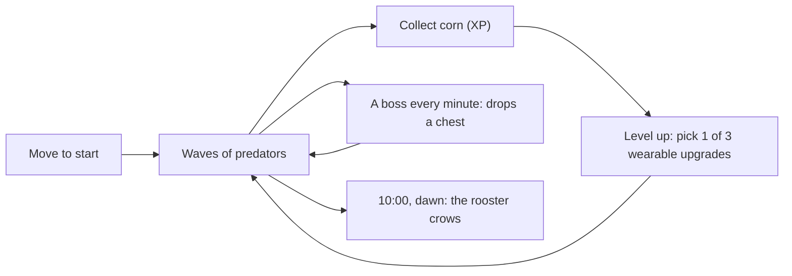

# Quiquiriqui

> An isometric **horde-survival arcade game** where a hen dresses up in everything she earns. Under **32 KB**. No libraries, no engines, no assets: everything is drawn and synthesized with code.

**Play:** _link coming soon_ · Built for **Build & Play**, the game challenge from [Build & Pitch](https://www.open2.io/build-and-pitch/play) (open2.io), Nov 4–18, 2026.

---

## Table of Contents

1. [The Challenge](#the-challenge)
2. [Game Concept](#game-concept)
3. [Design Pillars](#design-pillars)
4. [Technical Approach](#technical-approach)
5. [Getting Started](#getting-started)
6. [Roadmap](#roadmap)
7. [Rules Compliance Checklist](#rules-compliance-checklist)

---

## The Challenge

**Build & Play**: _"Vibecode the coolest arcade game. And make it hard."_ An online challenge, open worldwide.

### Rules

| # | Rule | What it means |
|---|------|---------------|
| 01 | **32 KB** | Everything the browser downloads to play the game adds up to 32 KB at most. Any files, any language. |
| 02 | **Your own code** | No libraries, frameworks or engines (no Phaser, Three.js, React…). Only what the browser ships with. |
| 03 | **Zero assets** | No images, audio or fonts. Everything is drawn and sounds through code. |
| 04 | **New repo** | Public GitHub repo created during the challenge, plus a playable link (GitHub Pages, Vercel or itch.io). |
| 05 | **Original** | No clones, no characters from other games. |
| 06 | **One per person** | One game per Open2 account. |

**Prize:** the most-voted game wins **\$50 USD** in cash. You need an Open2 account to vote. Each account gets one vote per game (your own included) and can vote for as many games as it likes.

### Timeline

| Date | Event |
|------|-------|
| **Nov 4** | Submissions open |
| **Nov 18** | Submissions close at 23:59 (Guatemala time) |
| **Nov 19** | Voting opens (after games are reviewed) |
| **Nov 21** | Winner announced at Build & Pitch |

---

## Game Concept

A lone hen in an endless sunny meadow. Predators close in from every side, wave after wave, while the day turns to rain, snow and night. Her weapons fire on their own; **you only move**. Every level-up offers three upgrades, and **every upgrade is something she wears or carries**: a pot helmet, running boots, sunglasses, a feed basket, a cape. Glance at the hen and you see your build.

Rats arrive from the first second and foxes after a minute; snakes join at 3:00, crows at 5:00 and badgers at 7:00, and the last minute brings everything. A **boss** (a big, tough version of a predator) comes on most minutes and drops a **chest** with one or three upgrades. Every 20 seconds a **crate** appears; broken, it leaves a magnet (pulls in every kernel), a bomb (clears the screen), food or corn. The day turns to rain, snow and night, and at 10:00 the sun comes up.

She starts with **Egg Toss** and can carry six of seven weapons and all six passives:

| Upgrade | What it does | What she wears |
|---------|--------------|----------------|
| **Egg Toss** | Lobs eggs at the nearest predator | Her eggs turn speckled, then golden |
| **Peck** | A jab up close | A steel beak |
| **Feather Darts** | Tail feathers shot behind her, so running away fights back | Blue-tipped tail feathers |
| **Corn Spray** | A fan of kernels at a random predator | A bandolier of corn |
| **Wing Gust** | Wind that hurts and shoves back everything close | A bigger wing with blue flight feathers |
| **Chick Orbit** | Chicks circle her and nip | The chicks themselves |
| **Thunder Comb** | Lightning on predators on screen | A zigzag lightning comb |
| **Running Boots** | Runs faster | Red boots |
| **Feed Basket** | Pulls corn from farther away | A basket of corn on her back |
| **Pot Helmet** | Takes less damage per bite | A pot on her head |
| **Sunglasses** | More damage | Dark shades |
| **Hero Cape** | More health | A red cape |
| **Lucky Bandana** | Dodges some bites | A dotted neckerchief |

Each item has three looks: levels 1–2, levels 3–4 (bigger or more detailed) and level 5 (golden).

Survive **10 minutes**. At dawn the rooster crows (_¡quiquiriquí!_) and the predators flee. Then choose: end the run, or **keep going** into day 2, 3, 4... where the timeline starts over with tougher, faster and more numerous predators each day, until she falls.

### Playing again and again

- **Levels never end.** Each level costs more corn than the last. Once every item is maxed, level-ups offer **boons** (more damage, speed, reach, health or fire rate, or a warm meal) with no limit.
- **Peril 0 to 5.** A dawn unlocks the next peril: more predator health, speed, numbers and bite. Each peril keeps its own best time.
- **Three hens.** The white hen starts with Egg Toss; the speckled hen (unlocked by your first dawn) with Peck; the black hen (a dawn at peril 2) with Feather Darts.
- **Golden eggs and the shop.** Every run earns golden eggs (time, kills, dawn, peril). Spend them on five permanent upgrades: Tough Hide, Strong Legs, Sharp Eye, Big Crop and Quick Learner.



### Controls

| Device | Move | Pick an upgrade |
|--------|------|-----------------|
| Keyboard | WASD or arrow keys | 1, 2, 3 |
| Mouse | Hold a button and steer from the screen center | Click a card |
| Touch | A stick opens wherever your thumb lands (works with the phone upright or sideways) | Tap a card |
| Gamepad | Left stick | (planned) |

On the title screen: **Q / E** pick a hen, **Z / C** pick a peril, **B** opens the shop (1-5 buy), **M** turns the music off and on. On a touch screen, tap either half of a row. At dawn, **1** keeps going and **2** ends the run.

The game pauses when the window loses focus.

---

## Design Pillars

1. **Nothing to learn.** Movement only: the hen fights on her own. Easy on mobile.
2. **You can see your build.** Each upgrade is a visible item on the hen, and items change look as they level up.
3. **A calm, readable meadow.** The ground is drawn in large quiet patches so the hen and the threats always stand out.
4. **Hard, arcade.** A minute-by-minute timeline of denser waves and bosses. Ten minutes, no saves, one goal: dawn.

---

## Technical Approach

The engine is reused from our own earlier prototype (see [Archive](#archive)), adapted for an open field:

- **Single `index.html`**, everything inlined.
- **320 pixels wide, as tall as the screen's shape allows** (180 on a wide screen, up to 640 on a phone held upright), scaled up with smoothing off: by whole numbers from 2× up, by a fraction on small screens so a phone is filled edge to edge.
- **2:1 isometric projection**. Input is read as a screen direction and converted to world space, so "up" always walks up the screen.
- **Endless meadow**: five flat tile types baked once, pixel by pixel so diamonds tile without seams; each cell picks its tile from a stateless hash, and only visible cells are drawn.
- **Procedural pixel sprites**: shape functions rasterized at boot with an automatic 1 px outline and a hit-flash copy. The hen is a stack of layers (items in front, her body, the cape behind) re-baked whenever her outfit changes, so one outline wraps everything she wears.
- **Our own 3×5 pixel font**, written as data in the code (five octal digits per glyph) and drawn pixel-exact with an ink outline, so text stays as crisp as the art at any scale. No font files, no system fonts.
- **Fixed 60 Hz timestep**, object pools (300 predators, 300 kernels, 96 projectiles), hitstop, screen shake and a smoothed camera.
- **Seeded gameplay randomness**: a run replays exactly from its seed, which keeps tests and the bot reproducible.
- **Data tables** for predators, the wave timeline and the upgrades, so new content is mostly data.
- **Own parametric WebAudio synth** (tone + noise + pitch slide + ring modulation), with every effect pitched slightly differently each time and a voice per predator.
- **Original music on the same synth**: a humming voice, a galloping bass and a noise drum kit play a theme written for this game. A tiny sequencer reads one character per eighth note and schedules ahead on the audio clock; the part follows the run (day, boss, night, dawn). Effects and music share a compressor so a full horde stays clear.

### Size Budget

Only the shipped file is gated: `dist/index.html` after Terser **and** Roadroller.

| Build | Terser output | Shipped `dist/index.html` |
|-------|---------------|---------------------------|
| M0 skeleton (measured Nov 5, 2026) | 10,936 B | 6,360 B (19.4%) |
| M1 core loop (measured Nov 5, 2026) | 28,358 B | 13,426 B (41.0%) |
| M2 dress-up (measured Nov 5, 2026) | 36,099 B | 16,188 B (49.4%) |
| M3 the ten minutes (measured Nov 5, 2026) | 43,915 B | 18,784 B (57.3%) |
| Polish and phone fit (measured Nov 5, 2026) | 44,333 B | 18,944 B (57.8%) |
| Spawns on any screen and the audio pass (measured Nov 5, 2026) | 48,734 B | 20,800 B (63.5%) |
| Faster hen, snappier magnet, new hit sound (measured Nov 5, 2026) | 49,013 B | 20,878 B (63.7%) |
| Endless days, peril, hens, shop, boons (measured Nov 5, 2026) | 55,254 B | 23,347 B (71.2%) |
| Pixel font (measured Nov 5, 2026) | 56,085 B | 23,791 B (72.6%) |
| **Final target** | n/a | **≤ 32,768 bytes** |

---

## Getting Started

Requires **Node.js 18+**.

```bash
npm install         # dev-only tools (esbuild, terser, roadroller)
npm run dev         # serve src/ unminified at http://localhost:8080
npm test            # headless 60 Hz simulation tests at 5x speed
npm run playtest    # build, then headless Chrome plays at 5x with real input + screenshots
npm run build       # full build → dist/index.html (+ size and asset gate)
npm run build:fast  # Terser only → dist/fast.html, to check minified code still runs (not size-gated)
npm run size        # re-check the size of dist/index.html
```

The build **fails** if `dist/index.html` would be over **32,768 bytes** or references any external resource. A failed build leaves the previous `dist/index.html` untouched.

To watch a bot play at 5x, run `npm run dev` and open `http://localhost:8080/?autoplay`. The bot dodges, collects corn, picks cards and starts over after a game over. Add `&speed=N` for another speed, or `&peaceful` to walk around with no predators. The wardrobe, `http://localhost:8080/__dev/wardrobe.html`, shows every worn item at each of its looks, and the sound board, `http://localhost:8080/__dev/sounds.html`, plays every sound effect and each part of the music. The playtest needs Node 22+ and Chrome or Edge (`CHROME_PATH` to override). All test tooling is dev-only and never shipped.

---

## Roadmap

| Status | Milestone | Deliverable |
|--------|-----------|-------------|
| ✅ | **M0: Skeleton** | Endless isometric meadow, the hen walking in 8 directions, title, pause on blur, clock, tests. |
| ✅ | **M1: Core loop** | Rats and Foxes on a wave timeline (minutes 0–3, then a ramp). Three weapons (Egg Toss, Peck, Feather Darts) and three passives (Running Boots, Feed Basket, Pot Helmet). Corn XP with a magnet, level-up cards (1/2/3, click, tap), bites, game over and a saved best time. |
| ✅ | **M2: Dress-up** | Seven weapons (adds Corn Spray, Wing Gust, Chick Orbit, Thunder Comb) and six passives (adds Sunglasses, Hero Cape, Lucky Bandana). Every item drawn on the hen, with three looks as it levels; she is re-baked whenever her look changes. |
| ✅ | **M3: The 10 minutes** | A ten-minute timeline with snakes, crows and badgers; bosses with chests; crates with a magnet, a bomb or food; rain, snow and night; the dawn win at 10:00. |
| ⬜ | **M4: Polish & ship** | A performance pass, a test on real phones, and the deploy to GitHub Pages. Done so far: the outfit and rat readability pass, the phone fit, predators born all around the hen on any screen, the audio pass, and replayability (steeper XP, endless boons, endless days, peril levels, three hens, the shop). |

---

## Rules Compliance Checklist

- [ ] `dist/index.html` ≤ 32,768 bytes (enforced by `npm run build`)
- [ ] No external requests: no CDN, fonts, images or audio (enforced by `npm run build`)
- [ ] No third-party runtime code: all shipped code is written for this project
- [ ] No image, audio or font assets: everything is procedural
- [ ] Public GitHub repo created during the challenge (Nov 4–18, 2026)
- [ ] Playable link (GitHub Pages)
- [ ] Original names, characters and world

---

License: _TBD_.
